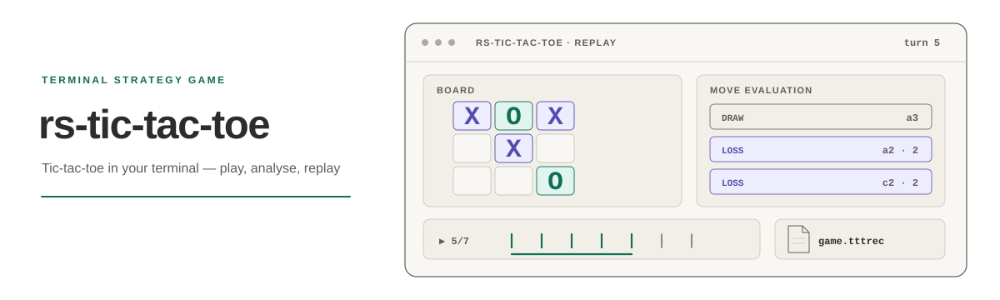

<p align="center"></p>

[English](README.md) | **日本語**

# rs-tic-tac-toe

ターミナルで遊ぶ三目並べです．ゲーム木をすべて読み切る CPU と対戦でき，ヒントを出したり，各マスの評価（勝ち・引き分け・負け）を表示したりできます．`.tttrec` 形式の棋譜ファイルから対局を再生でき，録画にも使えます．描画には [ratatui](https://ratatui.rs) を使っています．

## インストール

```sh
cargo install --git https://github.com/akitenkrad/rs-tic-tac-toe
```

クローンして実行する場合:

```sh
cargo run --release
```

端末サイズは 80 × 24 以上が必要です．True Color（24bit）対応の端末を推奨します．

## クイックスタート

```sh
rs-tic-tac-toe                                            # play against the CPU
rs-tic-tac-toe replay examples/records/x-wins.tttrec      # replay a game record
```

## ドキュメント

- [遊び方](docs/gameplay.ja.md) — ルール，マスの呼び方，設定，操作
- [必勝法と完全読み](docs/strategy.ja.md) — 引き分けになる理由，両取り，ミニマックス探索
- [棋譜とリプレイ](docs/replay.ja.md) — `.tttrec` 形式，リプレイのオプション，録画
- [開発者向け情報](docs/development.ja.md) — ソース構成とテスト

[rs-games](https://github.com/akitenkrad/rs-games)（Rust 製ターミナルゲームのコレクション）に収録しています．

## ライセンス

[MIT](LICENSE)
