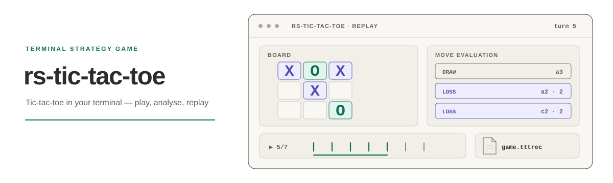

<p align="center"></p>

**English** | [日本語](README.ja.md)

# rs-tic-tac-toe

Tic-tac-toe in your terminal. Play against a CPU that searches the whole game tree, ask for hints, see every move evaluated as a win, draw or loss, and replay recorded games from `.tttrec` files — handy for recording videos. Built with [ratatui](https://ratatui.rs).

## Install

```sh
cargo install --git https://github.com/akitenkrad/rs-tic-tac-toe
```

Or from a clone:

```sh
cargo run --release
```

A terminal of at least 80 × 24 cells is required; true colour (24-bit) is recommended.

## Quick start

```sh
rs-tic-tac-toe                                            # play against the CPU
rs-tic-tac-toe replay examples/records/x-wins.tttrec      # replay a game record
```

## Documentation

- [Playing rs-tic-tac-toe](docs/gameplay.md) — rules, cell names, settings and controls
- [Strategy and perfect play](docs/strategy.md) — why the game is a draw, forks, and the minimax search
- [Game records and replay](docs/replay.md) — the `.tttrec` format, replay options and recording videos
- [Development](docs/development.md) — source layout and tests

Part of [rs-games](https://github.com/akitenkrad/rs-games), a collection of terminal games written in Rust.

## License

[MIT](LICENSE)
